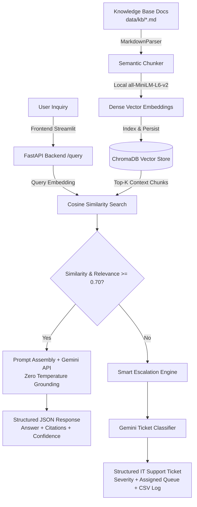
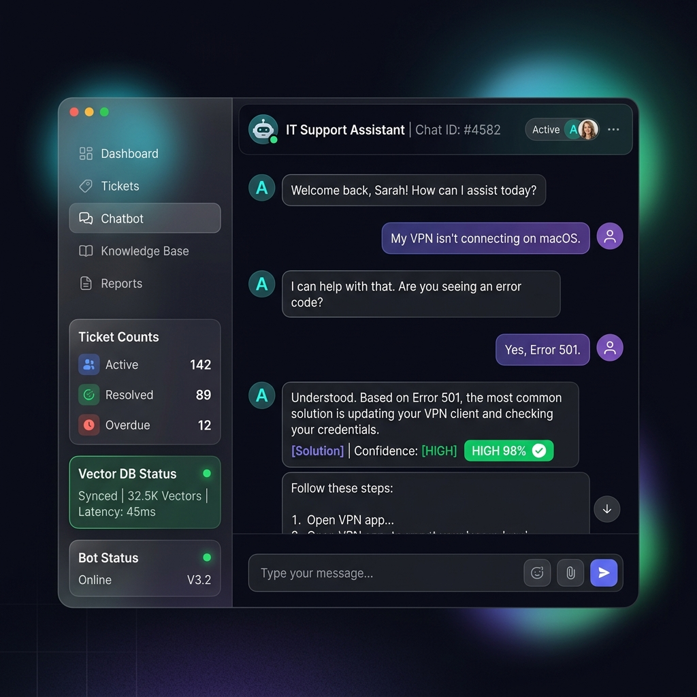

# Seagate Product Support Chatbot

[](https://www.python.org/)
[](https://fastapi.tiangolo.com/)
[](https://streamlit.io/)
[](https://www.trychroma.com/)
[](https://ai.google.dev/)
[](LICENSE)

An automated, production-ready Level-0 (L0) IT and hardware product support self-service knowledge base assistant. This application parses Standard Operating Procedures (SOPs) and technical documentation written in Markdown, computes dense vector representations locally using `SentenceTransformers` (`all-MiniLM-L6-v2`), indexes embeddings in a persistent `ChromaDB` vector store, performs grounded retrieval queries with `Google Gemini API`, and triggers automated service ticketing classifications if confidence scores fall below threshold rules.

---

## 1. Problem Statement

Enterprise IT and product service desks are overwhelmed by high volumes of repetitive, low-complexity Level-0 (L0) inquiries (e.g., storage driver installations, firmware updates, VPN connection drops, password resets, and network printer setups). Resolving these manually consumes costly engineering bandwidth, inflates operational costs, and leads to delayed turnaround times for end-users.

This project eliminates that bottleneck by providing a reliable, fully grounded, self-service Retrieval-Augmented Generation (RAG) assistant. It ensures that the chatbot only provides answers when high-quality documentation exists, and gracefully escalates to a human engineer with an auto-generated, categorized support ticket if it cannot resolve the inquiry with high confidence.

---

## 2. Architecture & Pipeline



### Ingestion Flow:
1. **Document Parsing**: Scans `data/kb/` for SOP articles and documentation.
2. **Structural Chunking**: Breaks documents down by H1, H2, and H3 headers, preserving metadata (article title, section headers).
3. **Local Vectorization**: Generates 384-dimensional dense vectors using local `SentenceTransformers` (`all-MiniLM-L6-v2`) with zero external API costs for indexing.
4. **Vector Storage**: Indexes chunk embeddings into a persistent `ChromaDB` collection configured for cosine distance.

### Query & Grounding Flow:
1. **Query Encoding**: Converts incoming user query to a dense vector.
2. **Nearest-Neighbor Retrieval**: Retrieves top-$k$ nearest context passages.
3. **Grounded Generation**: Combines the question and retrieved context into a strict system prompt for `gemini-1.5-flash` at temperature `0.0`.
4. **Structured JSON Validation**: Enforces JSON schema with fields `answer`, `confidence`, and `citations`.
5. **Confidence Gate & Auto-Escalation**: If vector similarity or model confidence falls below 70%, the system flags the issue for escalation, generates a categorized support ticket (Title, Priority, Problem Summary, Recommended Team), and persists it to the ticketing log.

---

## 3. UI Dashboard



The application provides an interactive Streamlit UI featuring:
- **Conversation Interface**: Real-time chat dialogue with confidence score badges and source citations.
- **Dynamic Re-indexing Panel**: One-click re-indexing of documents and vector database clearing.
- **Escalation Management**: Inline ticket submission forms with automatic priority and resolver-team routing.
- **Analytics Dashboard**: Real-time metrics on resolved vs. escalated tickets.

---

## 4. Project Structure

```
seagate-product-support-chatbot/
├── backend/
│   ├── app/
│   │   ├── api/
│   │   │   ├── endpoints.py         # FastAPI routes (/query, /ingest, /stats, /tickets)
│   │   │   └── schemas.py           # Pydantic request/response validation
│   │   ├── core/
│   │   │   └── config.py            # App settings, paths, environment variables
│   │   ├── data/                    # ChromaDB persistent store & ticket databases
│   │   ├── outputs/                 # Escalated tickets records
│   │   ├── services/
│   │   │   ├── embeddings.py        # SentenceTransformers local embedding service
│   │   │   ├── llm_helper.py        # Gemini API connector & JSON schemas
│   │   │   ├── rag_engine.py        # ChromaDB controller & similarity search
│   │   │   └── ticket_handler.py    # Ticket persistence and CSV exporter
│   │   └── main.py                  # FastAPI application entrypoint
│   └── requirements.txt             # Backend dependencies
│
├── frontend/
│   ├── components/
│   │   ├── analytics.py             # Performance & ticket analytics component
│   │   ├── chat.py                  # Chat dialogue and escalation form components
│   │   └── sidebar.py               # Sidebar controls (ingestion, API key, status)
│   ├── utils/
│   │   └── api_client.py            # Client connecting Streamlit to FastAPI
│   ├── app.py                       # Streamlit UI orchestrator
│   └── requirements.txt             # Frontend dependencies
│
├── tests/
│   └── test_rag.py                  # Automated test suite (Happy & Negative paths)
├── prompts.md                       # System and grounding prompt specifications
├── ai_usage_note.md                 # Architectural design and LLM engineering notes
├── .env.example                     # Environment template
└── README.md                        # Master documentation
```

---

## 5. Technology Stack

- **Backend Framework**: FastAPI, Pydantic, Uvicorn
- **Frontend UI**: Streamlit, Custom Dark-Mode CSS
- **Vector Database**: ChromaDB (persistent local SQLite store)
- **Embedding Model**: `sentence-transformers/all-MiniLM-L6-v2` (Local inference)
- **Large Language Model**: Google Gemini API (`gemini-1.5-flash` / `gemini-2.0-flash`)
- **Testing**: Pytest

---

## 6. Getting Started

### Prerequisites
- Python 3.11+
- Google Gemini API Key ([Get a free key here](https://aistudio.google.com/))

### Installation

1. **Clone the repository:**
   ```bash
   git clone https://github.com/ashok9847/seagate-product-support-chatbot.git
   cd seagate-product-support-chatbot
   ```

2. **Configure environment variables:**
   ```bash
   cp .env.example .env
   # Edit .env and insert your GEMINI_API_KEY
   ```

3. **Install Backend Dependencies:**
   ```bash
   cd backend
   pip install -r requirements.txt
   ```

4. **Install Frontend Dependencies:**
   ```bash
   cd ../frontend
   pip install -r requirements.txt
   cd ..
   ```

### Running Locally

1. **Start the FastAPI Backend:**
   ```bash
   cd backend
   uvicorn app.main:app --host 0.0.0.0 --port 8000 --reload
   ```

2. **Start the Streamlit UI (in a new terminal):**
   ```bash
   cd frontend
   streamlit run app.py
   ```

3. Open your browser at `http://localhost:8501`.
4. In the sidebar, click **Ingest & Re-index** to populate the vector database with the included SOP articles.

---

## 7. Running Tests

Run the test suite to validate document chunking, vector retrieval, grounding logic, and ticket generation:

```bash
pytest -v tests/test_rag.py
```

---

## 8. Sample Scenarios

### Scenario A: Grounded Knowledge Base Query (High Confidence)
- **Query**: *"How do I configure FortiClient VPN remote settings?"*
- **Response**:
  ```json
  {
    "answer": "To configure FortiClient VPN:\n1. Open FortiClient and select Configure VPN.\n2. Set VPN Type to SSL-VPN.\n3. Input Connection Name (e.g. Corporate Network).\n4. Set Remote Gateway to vpn.company.com and Port to 10443.\n5. Click Save. [Source: kb03_vpn_install_forticlient.md, Section: H1: FortiClient VPN Installation and Setup > H2: Installation Steps]",
    "confidence": 98,
    "citations": [
      "kb03_vpn_install_forticlient.md > H1: FortiClient VPN Installation and Setup > H2: Installation Steps"
    ]
  }
  ```

### Scenario B: Unindexed / Out-of-Scope Query (Escalation Triggered)
- **Query**: *"Can I order an external standing desk from the internal equipment portal?"*
- **Response**:
  ```json
  {
    "answer": "I could not find this in the knowledge base.",
    "confidence": 0,
    "citations": []
  }
  ```
- **Generated Support Ticket**:
  ```json
  {
    "ticket_id": "TKT-1001",
    "ticket_title": "Standing Desk Procurement Request",
    "problem_summary": "User inquired about policies for ordering an office standing desk. No matching SOP exists in the IT KB.",
    "priority": "Low",
    "recommended_team": "Facilities IT Services"
  }
  ```

---

## Author

**Ashok Aryal**
- GitHub: [@ashok9847](https://github.com/ashok9847)

---

## License

This project is licensed under the MIT License. See [LICENSE](LICENSE) for details.
